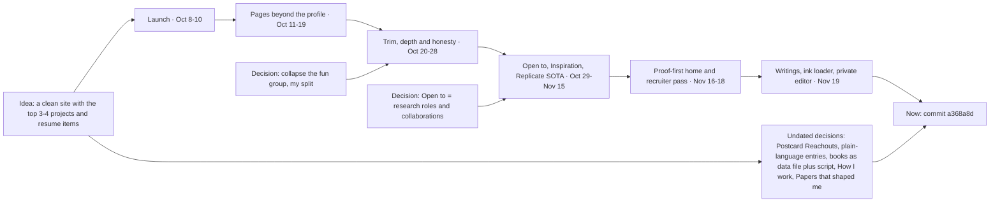
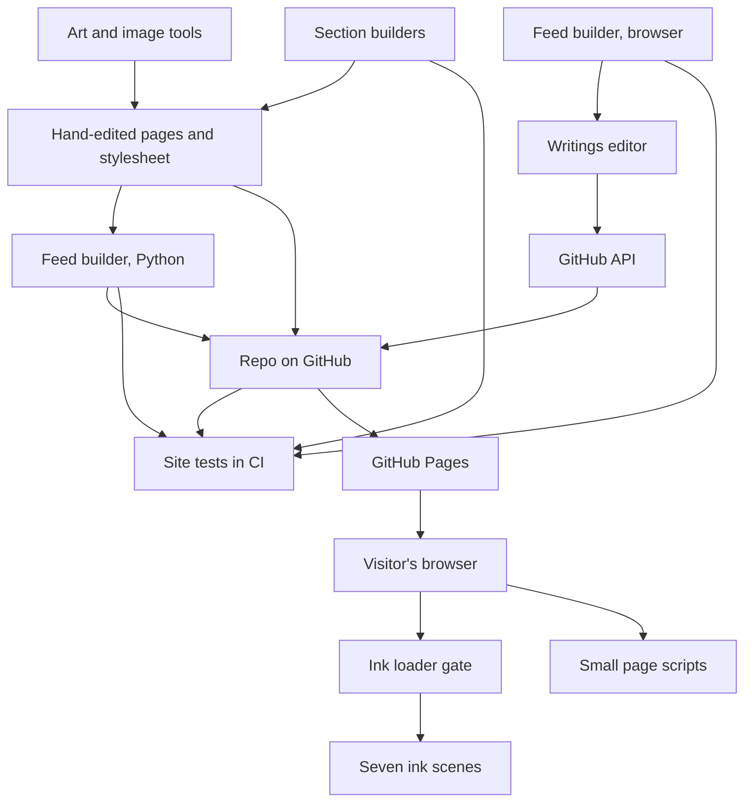
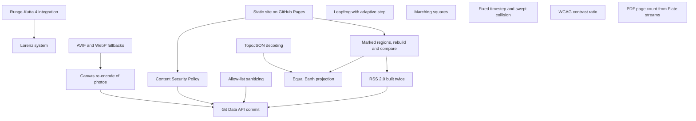

<!-- ProjectForge explainer at a368a8d -->
# How portfolio_website was built

portfolio_website is Amal Mehta's personal site at amalmehta.com. It shows research, projects, a resume, and pages on interests, travel, values and writing, for people who want to know what Amal works on and who Amal is. It works because the whole site is plain files served as they are: HTML is edited by hand, small scripts rebuild the parts that come from data, and tests rebuild those parts again to check they still match.

## Build history

- **Launch, Oct 8–10.** The profile, research, projects and resume went up. A writing blog was added, then archived the next day. The portrait was served as AVIF and WebP, project cards got looping clips, and automated site tests were added.
- **Pages beyond the profile, Oct 11–19.** A Musings section and a Values page came in, then a live Skills list, Hobbies as tiles with moving icons, the hidden Messi replay, and Media I love on Interests.
- **Trim, depth and honesty, Oct 20–28.** MEHTA Learning was removed. The 11 things built for fun went into a Built for fun group that stays closed until clicked, so the profile is about 1,800 px shorter on phones. An honesty pass removed claims that weren't right (graduate classes, soloing Cerro Torre, "long-horizon work"). Cuts went into "save for later" comments instead of being deleted.
- **Open to, Inspiration, Replicate SOTA, Oct 29–Nov 15.** Open to gained a line about beneficial products. Ramanujan, Kobe Bryant and Favorite artists joined. Replicate SOTA took Post Training Lab's featured spot with a deep dive and its recall chart.
- **Proof-first home and recruiter pass, Nov 16–18.** The home page now leads with the strongest work. Toy projects were saved for later, jobs lead with results, and the deep dives got Related work, story spines and a storyboard. Resumes for specific companies were added.
- **Writings, ink loader, private editor, Nov 19.** "A hard day" opened Writings, and Writings joined the RSS feed. The home page now opens on one of seven ink scenes, starting with the Lorenz butterfly. A private editor at `/write/` publishes posts and photos straight to GitHub. The site's resume became the Meta Simulation CV/ML version.

## Code map

| Part | File | What it does |
|---|---|---|
| Hand-edited pages | `index.html`, `interests.html`, `photos.html`, `thinking.html`, `values.html`, `writings.html` | The content itself, written as plain HTML with no framework. |
| Stylesheet | `styles.css` | Layout, fonts, and colour tokens that switch with the system's dark mode. |
| Section builders | `tools/make-books.py`, `tools/make-map.py`, `tools/make-case-studies.py`, `tools/make-sitemap.py` | Rebuild the Books section from `books.json`, the Travel map, the `project-*.html` deep dives, and `sitemap.xml` plus the "Evolving site" month in every header. |
| Art and image tools | `tools/draw-places.py`, `tools/draw-research-art.py`, `tools/make-images.sh` | Draw the SVG illustrations in code, and turn JPEGs into the AVIF and WebP copies the pages serve. |
| Feed builder, Python | `tools/make-feed.py` | Builds `feed.xml` from the thoughts in `thinking.html` and the pieces in `writings.html`. |
| Feed builder, browser | `write/feed.js` | The same feed, built the same way in JavaScript, so the editor can update `feed.xml` in the same commit as a post. |
| Writings editor | `write/write.js`, `write/index.html` | A private page that loads `writings.html` from GitHub, lets Amal edit a post in place, and commits the result. |
| GitHub API | used in `write/write.js` | The editor's only network connection: it reads files and writes blobs, trees, commits and the branch ref. |
| Site tests | `tests/test_site.py`, `.github/workflows/tests.yml` | Standard-library checks run on every push to main and on every pull request. |
| Weekly checks | `.github/workflows/links.yml`, `tools/check-links.py`, `tools/check-staleness.py` | Every Monday, checks external links and flags "kept current" dates older than six months. |
| Ink loader gate | `chaos.js` | Runs in `<head>` before the first paint. It decides whether to show the opening scene and which one. |
| Seven ink scenes | `chaos-scenes.js` | Simulates each scene up front, then draws it on a canvas in about two seconds. |
| Small page scripts | `email.js`, `pong.js`, `messi.js`, `tiles.js`, and others | Restore the hidden email address, run the hidden games, and play the tile animations. |
| Resumes | `resume/`, `_resumes/build.sh` | LaTeX sources built to PDF with Tectonic and to Word with pandoc, with a check that each fits on one page. |

## Concepts

**Static site on GitHub Pages** — The repo's files are served exactly as they are, with no build step on the server. `CNAME` points the site at amalmehta.com. Folders whose names start with `_` (`_archive/`, `_drafts/`, `_resumes/`) are left unpublished, which is how cut content is kept but hidden (`docs/SYSTEM-DESIGN.md`). This project needs it because there's nothing to run or maintain: any change is a commit.

**Marked regions, rebuild and compare** — Some parts of a hand-edited page come from data. Each one sits between two HTML comments, such as `<!-- books:start … -->` and `<!-- books:end -->`. A builder script replaces only the text between them (`update()` in `tools/make-books.py` and `tools/make-map.py`). The tests then run the builder again and fail if the page has changed, so the data and the page can't drift apart (`test_page_matches_books_json` and `test_feed_matches_thinking_page` in `tests/test_site.py`). The builders also reject bad input with a plain message, for example stars that aren't in halves between 0 and 5 (`card()` in `tools/make-books.py`).

**Content Security Policy** — A CSP (Content Security Policy) is a rule the page gives the browser about where scripts, images and connections may come from. Every public page uses `default-src 'self'; object-src 'none'; base-uri 'self'; form-action 'none'`, and a test checks that no page has inline scripts, `style=` attributes or `on…=` handlers (`test_pages_only_run_their_own_files` in `tests/test_site.py`). The editor's policy adds `connect-src 'self' https://api.github.com`, so even if a script were injected, it couldn't send the GitHub token anywhere else (`write/index.html`, checked by `test_locked_down`).

**RSS 2.0 built twice** — RSS is an XML file that feed readers poll for new items. Each item needs a title, link, guid (a permanent ID) and a `pubDate` in RFC 822 form, for example `Thu, 19 Nov 2026 12:00:00 +0000`. The hard part is that the feed is built in two places: `tools/make-feed.py` for edits made by hand, and `write/feed.js` for posts published from the editor. Both must produce identical bytes, or the feed test fails after the next publish. So `feed.js` copies Python's behaviour exactly, including what `str.strip()` counts as whitespace (`strip` in `write/feed.js`). `test_browser_feed_matches_python` runs `feed.js` in Node and compares its output with the Python builder's.

**Git Data API commit** — GitHub's low-level API builds a commit in four steps. Upload each new file as a *blob*. Make a *tree* (a folder listing) on top of the current one. Make a *commit* that points to that tree and to its parent commit. Then move the branch *ref* to the new commit. The editor does exactly this in `publish()` in `write/write.js`, so a post, its photos and the new `feed.xml` all land in one commit. It moves the ref with `force: false`, which only succeeds if the new commit builds on the current tip of `main`. Before that, it re-reads the head and stops if `writings.html` changed since the page loaded. Together, these two checks keep a stale editor tab from overwriting newer work.

**Allow-list sanitizing** — The editor body is `contenteditable`, so the browser can insert any HTML into it, and so can a paste. `cleanInline()` in `write/write.js` rebuilds each paragraph from scratch. It keeps only text, `<strong>`, `<em>` and links whose address passes `safeHref()` (http, https, mailto, `#`, or a path on this site). Every other element is dropped, but its words are kept. Pastes are turned into plain paragraphs first, and drag-and-drop is blocked. This matters because whatever the editor writes is published on the site as-is.

**Canvas re-encode of photos** — Drawing a photo onto a `<canvas>` and exporting it gives brand-new image bytes. EXIF data (camera details, GPS location) doesn't come along. `addPhoto()` in `write/write.js` scales the photo to at most 1600 px wide, exports a JPEG at quality 0.84, and also a WebP at 0.8 when the browser can make one. Safari can't, so there it keeps the JPEG only. It won't add the photo without alt text.

**AVIF and WebP fallbacks** — AVIF and WebP are image formats much smaller than JPEG. A `<picture>` element lists them as `<source>`s, and the browser uses the first one it supports, falling back to the JPEG. `tools/make-images.sh` makes the 960 px copies, plus copies up to 1600 px for Featured cards, and never scales an image up. `test_picture_variants_exist_with_same_shape` checks that the copies exist and keep the original's shape.

**Runge-Kutta 4 integration** — A way to step a system of differential equations forward in time. Each step takes four slope samples and averages them, which is far more accurate than a single Euler step of the same size. The Lorenz and double-pendulum scenes use it (`rk4` in `chaos-scenes.js`).

$$p_{n+1} = p_n + \tfrac{\Delta t}{6}\left(k_1 + 2k_2 + 2k_3 + k_4\right)$$

**Lorenz system** — Three equations whose solutions never settle into a repeating loop, and where tiny differences in the start grow very fast. Scene 0 runs two paths that start 0.00001 apart in x. It draws them as one ink line until they are more than 0.3 apart, then in two colours (`SCENES[0]` in `chaos-scenes.js`). That moment of splitting is the whole picture.

$$\dot x = 10(y - x),\quad \dot y = x(28 - z) - y,\quad \dot z = xy - \tfrac{8}{3}z$$

**Leapfrog with adaptive step** — A step method for gravity. It updates velocity by half a step, position by a full step, then velocity by another half step. Over long runs it keeps energy close to constant. In the three-body scene the step shrinks as $r_{\min}^{1.5}$ when two bodies pass close, because a fixed step would fling them apart (`SCENES[3]` in `chaos-scenes.js`).

**Marching squares** — An algorithm that draws contour lines from a grid of heights. For each grid cell and each contour level, it finds the edges where the level is crossed, places a point on each by linear interpolation, and joins them. Scene 5 uses it to draw the reward landscape before an agent climbs it by noisy gradient ascent with momentum (`SCENES[5]` in `chaos-scenes.js`).

**Fixed timestep and swept collision** — Physics runs at a fixed 120 steps per second, whatever the screen's frame rate. Time builds up in an accumulator and is used up in whole steps. Drawing then blends the last two states by the fraction left over (`loop()` and `draw()` in `pong.js`). Collisions check whether the ball's front edge *crossed* a paddle's face during the step, not just whether it ended up inside. Otherwise a fast ball could jump past a paddle in one step (`hit()` in `pong.js`).

**TopoJSON decoding** — TopoJSON stores borders as shared *arcs*. Each arc is a list of whole-number offsets from the previous point, with a scale and a shift that turn them back into longitude and latitude. A negative arc index means "the arc with index `~i`, reversed". `decode()` and `ring()` in `tools/make-map.py` undo this using the bundled `tools/data/world-atlas-countries-110m.json`.

**Equal Earth projection** — A world map projection that keeps areas in true proportion and looks close to a globe. `equal_earth()` in `tools/make-map.py` implements it, with $A_1..A_4 = 1.340264, -0.081106, 0.000893, 0.003796$ and $M = \sqrt3/2$:

$$\theta = \arcsin(M\sin\varphi),\quad x = \frac{\lambda\cos\theta}{M\,(A_1 + 3A_2\theta^2 + \theta^6(7A_3 + 9A_4\theta^2))},\quad y = \theta\,(A_1 + A_2\theta^2 + \theta^6(A_3 + A_4\theta^2))$$

**WCAG contrast ratio** — The accessibility standard's measure of how readable text is against its background. Each sRGB channel is turned back into linear light, then weighted into a luminance $L$. The tests require at least 4.5:1 for every listed text and background pair, in both themes (`contrast()` and `test_text_contrast_in_both_themes` in `tests/test_site.py`).

$$\text{ratio} = \frac{L_{\text{light}} + 0.05}{L_{\text{dark}} + 0.05},\qquad L = 0.2126R + 0.7152G + 0.0722B$$

**PDF page count from Flate streams** — The resume must be one page, and the tests use only Python's standard library. In a PDF, the page count can sit inside compressed (Flate) object streams. So the test inflates every stream with `zlib` and reads `/Count` from the `/Type /Pages` object (`test_pdf_is_one_page` in `tests/test_site.py`). `_resumes/build.sh` uses the same idea to count `/Type /Page` objects and warns when a resume runs over.

## One input, start to finish

The input: Amal writes a new post with one photo in the editor and presses Publish.

1. **Open the editor.** `write/index.html` loads `feed.js` and `write.js`. `write.js` blanks the page if it's inside a frame. It then reads a saved token with `store.get()` and calls `signIn()`.
2. **Check the token.** `signIn()` calls `gh("/repos/amalmehta/amalmehta.github.io")` and refuses the token unless `permissions.push` is true. The token stays in `sessionStorage`, or in `localStorage` if Remember is ticked (`store.set`).
3. **Load the current site.** `load()` reads the tip of `main` with `headSha()`. Then `rawAt()` fetches `writings.html` and `thinking.html` at exactly that commit.
4. **Find the posts.** `articles()` finds each `<article class="writing" id="…">` and skips any inside "Saved for later" comments. `parsePost()` splits each one into title, written date, posted date and body blocks. The newest post opens by default.
5. **Start a new post.** The New post button calls `fill()` with an empty post. Typing runs `count()` for the word count. About 800 ms after typing stops, `saveDraft()` stores a draft in `localStorage` under `write-draft:new`. Pastes go through the paste handler, which turns them into plain paragraphs.
6. **Add the photo.** `addPhoto()` decodes the file with `createImageBitmap`, scales it to at most 1600 px wide, and encodes a JPEG and a WebP. It asks for alt text and an optional caption. It names the photo `images/writings/<date>-<random>.jpg` and keeps the encoded bytes in the `pending` map. `rawBlock()` shows it in the body from memory, since it isn't on the site yet.
7. **Collect and clean.** On Publish, `publish()` calls `collect()`, which runs every paragraph through `cleanInline()`. A new post gets its ID from `slug()`: the title in lower case with dashes, made unique against existing IDs.
8. **Check nothing changed.** `publish()` calls `headSha()` again. If `main` moved and `writings.html` is different, it stops, keeps the draft, and asks for a reload.
9. **Edit the page text.** `applyEdit()` inserts the output of `serialize()` at the top of `
`, just after the template comment, so newest comes first.
10. **Rebuild the feed.** `window.buildFeed()` (`build()` in `write/feed.js`) rebuilds `feed.xml` from `thinking.html` and the new `writings.html`. A piece's summary is its first paragraph after the dates.
11. **Commit.** Still in `publish()`: fetch the base commit. POST a blob for the JPEG and one for the WebP (`photosIn()` keeps only the photos still in the post). POST a tree with `writings.html`, `feed.xml` and the photo blobs on top of `base_tree`. POST a commit whose parent is the head. Finally, PATCH `refs/heads/main` with `force: false`. A 409 or 422 reply means the site changed during publishing, and the draft is kept.
12. **Go live and get checked.** GitHub Pages serves the new commit (the editor says "live in about a minute"). The push to `main` triggers `.github/workflows/tests.yml`, which runs `python -m unittest discover tests`. `test_feed_matches_thinking_page` re-runs `tools/make-feed.py` and compares its output with the committed `feed.xml`. `test_browser_feed_matches_python` checks the two builders still agree. The editor doesn't update `sitemap.xml` or the "Evolving site" month in the headers. Those change only when `tools/make-sitemap.py` is run by hand, and no test checks that they're fresh.

## Where this came from

Written from the spec, the decisions, git history and the code as of commit a368a8d.
